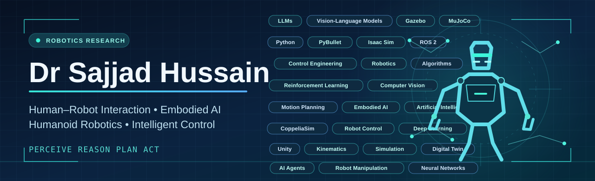
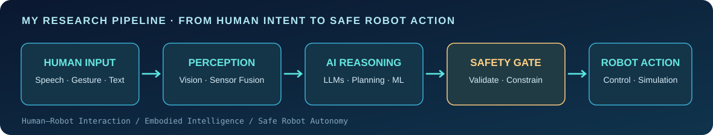

  

  
  

### Hello, I'm Dr Sajjad Hussain 👋

I am a **Robotics & AI researcher and lecturer** working on **human–robot interaction, intelligent robot control, embodied AI and multimodal machine learning**. My projects explore how robots can **perceive human intent, reason about tasks and act safely** in simulation and robotic systems.

**Research interests:** Human–Robot Interaction · Humanoid Robotics · Robot Manipulation · Computer Vision · Large Language Models · Reinforcement Learning · Motion Planning

### 🔬 From human intent to intelligent robot action

  

### 🤖 Robotics, Humanoids & Human–Robot Interaction

| Project | What it demonstrates |
| :--- | :--- |
| **[G1-LLM-Humanoid-HRI-MuJoCo](https://github.com/sh1755/G1-LLM-Humanoid-HRI-MuJoCo)** | Language-guided, safety-validated interaction with a simulated Unitree G1 humanoid. **README available; full source upload pending.** |
| **[Franka MediaPipe Body Pose & Gesture Control](https://github.com/sh1755/Franka_MediaPipe_BodyPose_HandGesture_Control)** | Computer vision, gesture input, Franka Panda and ROS 2 control. |
| **[Physics-Grounded Action Grammars](https://github.com/sh1755/PGAG-Robotic-Manipulation)** | Task-level robot manipulation, planning and execution architecture. |
| **[ROS 2 Panda Pick-and-Place](https://github.com/sh1755/ROS2-Panda-Pick-and-Place)** | MoveIt 2, RViz, motion planning and grasp-scene demonstrations. |
| **[Robot Forward & Inverse Kinematics](https://github.com/sh1755/ROS2-Forward-Inverse-Kinematics-repository)** | Kinematic modelling and manipulation fundamentals. |

### 🧠 LLMs, RAG & Applied AI

| Project | What it explores |
| :--- | :--- |
| **[Multimodal Knowledge-Graph RAG](https://github.com/sh1755/multimodal-kg-rag-publaynet)** | Scientific document understanding combining text, visual embeddings and knowledge graphs. |
| **[ConstructRAG AI](https://github.com/sh1755/constructrag-ai)** | Retrieval-augmented construction product intelligence. |
| **[ConstructAgent NLP](https://github.com/sh1755/constructagent-nlp)** | Natural-language queries, semantic retrieval and agentic analysis. |
| **[ConstructGNN AI](https://github.com/sh1755/construct-gnn-ai)** | Graph neural networks and AI reasoning for product relationships. |
| **[Energy Recommender System](https://github.com/sh1755/Energy-Recommender-System)** | Explainable energy recommendation research; **synthetic demonstration results** in the current repository. |

### 🛠️ Research tools & technologies

  
  
  
  
  
  
  
  
  
  

### 📚 Teaching & reproducible projects

I develop learning resources that connect **robotics theory, Python implementation and simulation**.

[AI for Human–Robot Interaction lab](https://github.com/sh1755/RO603-Week7-AI-HRI_Lecture) · [ROS 2 robot kinematics](https://github.com/sh1755/ROS2-Forward-Inverse-Kinematics-repository) · [Panda manipulation with MoveIt 2](https://github.com/sh1755/ROS2-Panda-Pick-and-Place)

---

  <b>Robotics × AI × Human–Robot Interaction</b> 
  <a href="https://github.com/sh1755/sajjad-portfolio/blob/main/PROJECTS.md">Browse the full project catalogue</a>
  &nbsp;·&nbsp;
  <a href="https://sajjad-portfolio-flax.vercel.app/">Visit my academic website</a>

